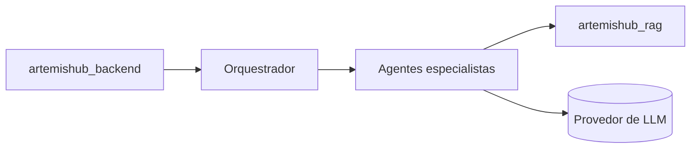

# 🌙 Artemis — Agents

### Sistema multiagentes LLM e modelos de IA do Artemis 💜

Este repositório contém a **inteligência** do Artemis: o sistema multiagentes que interpreta o perfil da usuária, consulta a base de conhecimento e gera orientações de carreira fundamentadas, além dos modelos de Machine Learning de apoio.

> 🚧 Em desenvolvimento. O primeiro sistema multiagentes está previsto para a **semana 4** e os agentes multimodais para a **semana 5** do roadmap.

## 🤖 Agentes previstos

Proposta inicial, a ser refinada pela equipe:

| Agente | Papel |
|---|---|
| **Orquestrador** | Entende a solicitação, decide quais agentes acionar e consolida a resposta final. |
| **Perfil e currículo** | Extrai competências, experiências e pontos fortes a partir do currículo. |
| **Inteligência salarial** | Fornece referências de remuneração e dados sobre desigualdade salarial. |
| **Oportunidades** | Recomenda vagas e caminhos de carreira alinhados ao perfil. |
| **Desenvolvimento** | Identifica lacunas de habilidades e sugere trilhas de aprendizado. |
| **Negociação** | Conduz simulações de negociação salarial e dá feedback. |
| **Orientação (RAG)** | Responde sobre direitos e carreira com citações, usando o `artemishub_rag`. |

## 🖼️ Multimodalidade

Na semana 5 os agentes passarão a lidar com entradas além de texto, por exemplo:

- 📄 Currículos em PDF ou imagem.
- 🎙️ Áudio nas simulações de negociação.
- 📊 Gráficos e tabelas na apresentação dos dados salariais.

## 🔌 Integrações

## 🛡️ Princípios

- **Respostas fundamentadas:** sempre que possível, citar as fontes recuperadas pelo RAG.
- **Abstenção:** quando não houver evidência suficiente, dizer que não sabe em vez de inventar.
- **Privacidade:** dados pessoais da usuária não são usados para treinar modelos.
- **Avaliação contínua:** métricas e conjuntos de teste versionados junto com o código.

## 🧰 Stack

A definir pela equipe (framework de agentes e provedor de LLM). As decisões serão registradas como ADR no [artemishub_docs](https://github.com/ArtemisHubApp/artemishub_docs).

## ▶️ Como executar

As instruções de instalação e execução serão adicionadas junto com o primeiro scaffold dos agentes.

## 📋 Contribuindo

As tarefas são acompanhadas no [kanban do projeto](https://github.com/orgs/ArtemisHubApp/projects). Ao abrir um PR, inclua `Closes #<número>` na descrição para que a issue seja movida automaticamente.

## 🗂️ Repositórios do projeto

| Repositório | Responsabilidade |
|---|---|
| [artemishub_docs](https://github.com/ArtemisHubApp/artemishub_docs) | Documentação, decisões de arquitetura e kanban do projeto |
| [artemishub_frontend](https://github.com/ArtemisHubApp/artemishub_frontend) | Interface web da plataforma |
| [artemishub_backend](https://github.com/ArtemisHubApp/artemishub_backend) | API, regras de negócio, autenticação e persistência |
| [artemishub_agents](https://github.com/ArtemisHubApp/artemishub_agents) | Sistema multiagentes LLM, multimodalidade e modelos de ML |
| [artemishub_rag](https://github.com/ArtemisHubApp/artemishub_rag) | Base de conhecimento, indexação e recuperação com citações |

## 👩‍💻 Nossa equipe

Desenvolvido pelo **Grupo 11**. Todas somos **AI Builders**, cada uma com uma frente principal de atuação:

<table>
  <tr>
    <td align="center">
      <a href="https://github.com/CamilaSilvaC">
         
        <b>Camila</b>
      </a>
       Engenharia de Dados · DevOps
    </td>
    <td align="center">
      <a href="https://github.com/AmandaElisa">
         
        <b>Amanda</b>
      </a>
       Software Architect · DevOps · Frontend
    </td>
    <td align="center">
      <a href="https://github.com/anajbsouza">
         
        <b>Ana Julia</b>
      </a>
       Ciência de Dados · Engenharia de Dados
    </td>
    <td align="center">
      <a href="https://github.com/eduardaoliveirazorg-jpg">
         
        <b>Eduarda</b>
      </a>
       Ciência de Dados · Software Architect
    </td>
  </tr>
</table>

---

  <i>Artemis — Mais conhecimento, confiança e oportunidades para mulheres em STEM.</i> 💜

