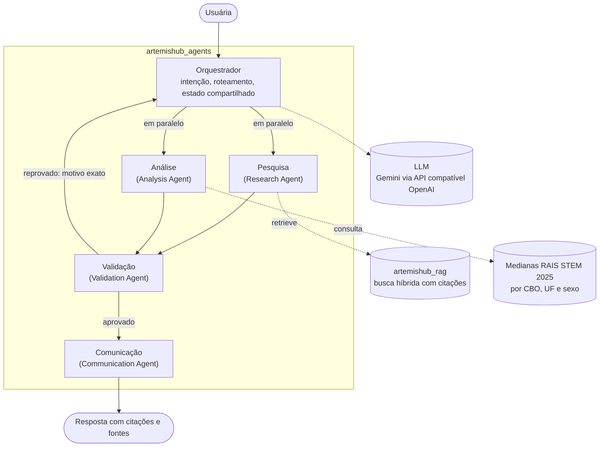
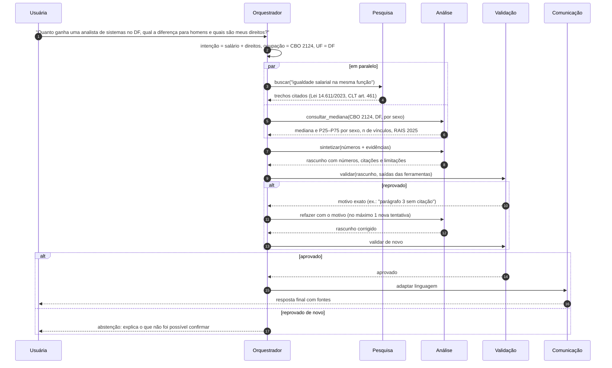

# Sistema multiagentes: primeiro protótipo (semana 4)

Documentação do entregável "Primeiro Protótipo Multiagente" (entrega em 20/11/2026): arquitetura dos agentes, responsabilidades e fluxo de colaboração. Segue o escopo do cronograma das semanas 4 a 7.

> **Status:** desenho fechado, implementação em andamento. O framework de orquestração ainda será registrado em ADR no [artemishub_docs](https://github.com/ArtemisHubApp/artemishub_docs) (tarefa 2 do cronograma). Este documento vale para as duas opções em discussão: LangGraph ou orquestrador em Python puro sobre o `llm_client`.

## Objetivo do protótipo

Cinco agentes respondem juntos a uma pergunta que cruza as duas bases do Artemis: os dados salariais da RAIS e a base de direitos do RAG.

Pergunta principal da demonstração:

> "Quanto ganha uma analista de sistemas no DF, qual a diferença para homens e quais são meus direitos?"

O enunciado pede no mínimo 2 agentes especializados. O protótipo tem 4 especialistas, um para cada papel citado no enunciado (Research, Analysis, Validation e Communication), mais o Orquestrador.

## Arquitetura



| Camada | Onde fica | Papel |
|---|---|---|
| Agentes | este repositório, `src/agents/` | orquestração e os quatro especialistas |
| Base de direitos | [artemishub_rag](https://github.com/ArtemisHubApp/artemishub_rag) | busca híbrida (vetorial + BM25) e validação de citações |
| Dados salariais | `data/processed/rais_stem_2025_brasil.parquet` (DVC) | origem das medianas e percentis; ver [dicionário de dados](dicionario_dados_rais.md) |
| LLM | provedor externo, via `llm_client` | interpretar a pergunta, sintetizar e reescrever |

O LLM nunca calcula números. Valores salariais vêm só da ferramenta de consulta à RAIS, e o LLM apenas os explica.

## Responsabilidades

| Agente | Papel no enunciado | Responsabilidade | Entrada | Saída | Não faz |
|---|---|---|---|---|---|
| **Orquestrador** | coordenação | Entende a pergunta, decide quais agentes acionar, mantém o estado compartilhado, controla o limite de tentativas e consolida a resposta. Também aplica as regras de entrada (pergunta fora de escopo, tentativa de injeção). | pergunta da usuária | intenção e parâmetros (ocupação, UF, salário informado) | inventar dados; seguir instruções vindas de documentos |
| **Pesquisa** | Research Agent | Consulta o RAG e devolve trechos com citação (fonte, página, artigo). | tema jurídico (ex.: igualdade salarial na mesma função) | lista de evidências citáveis | interpretar ou resumir a lei |
| **Análise** | Analysis Agent | Consulta as medianas e percentis da RAIS por ocupação, UF e sexo; cruza com as evidências da Pesquisa e sintetiza. Sempre avisa as limitações: só emprego formal, diferença bruta (sem controle por perfil) e ano dos dados. | parâmetros do Orquestrador + evidências | rascunho com números, citações e limitações | calcular números fora da ferramenta |
| **Validação** | Validation Agent | Confere se cada citação existe nas evidências, se cada número bate com a saída da ferramenta e se os avisos de limitação estão presentes. Se algo falhar, reprova com o motivo exato. | rascunho + saídas das ferramentas | aprovado, ou reprovado com motivo | reescrever a resposta |
| **Comunicação** | Communication Agent | Adapta a resposta para a usuária: linguagem simples e acolhedora, próximos passos claros. | rascunho aprovado | resposta final | alterar números, citações ou avisos |

### Regras da consulta salarial

- Grupo de comparação: família da CBO (4 dígitos) × UF × sexo, setor privado, RAIS 2025.
- Amostra mínima por recorte: 30 vínculos. Abaixo disso a ferramenta não devolve o número.
- Se a UF não tiver ao menos 30 mulheres e 30 homens na família, a consulta usa o Brasil todo e avisa. Se nem o Brasil tiver, devolve `suficiente: false` e nenhum número.
- A diferença entre mulheres e homens é **bruta**: compara medianas sem controlar escolaridade, tempo de casa ou jornada. Isso precisa aparecer na resposta. O controle por perfil é papel do modelo salarial (issues #4 e #5, semana 6).
- Além da mediana geral, a tabela traz a mediana só de quem tem jornada de 40 h ou mais (`p50_tempo_integral`), porque a jornada parcial, mais comum entre mulheres, puxa a mediana para baixo.

### Ferramenta salarial (`src/salarios.py`)

Os agentes não leem o parquet de 50 MB. Uma vez por versão da RAIS, `gerar` agrega o parquet em duas tabelas pequenas, versionadas no git em `data/agregados/`:

| Arquivo | Conteúdo |
|---|---|
| `salarios_rais_2025.csv` | n, P25, mediana, P75 e mediana em tempo integral por família da CBO × UF × sexo, incluindo os totais (`uf = BR`, `sexo = todos`) |
| `ocupacoes_cbo.csv` | ocupações de 6 dígitos com nome oficial e família, para achar a família a partir do que a usuária escreve |

```bash
uv run python -m src.salarios gerar --ano 2025
uv run python -m src.salarios consultar --ocupacao "analista de sistemas" --uf DF --salario 7500
```

O agente de Análise usa duas funções:

- `buscar_ocupacao("analista de sistemas")` devolve as ocupações mais parecidas e suas famílias (no exemplo, família 2124, Analistas de tecnologia da informação).
- `consultar("2124", "DF", salario=7500)` devolve os números por sexo, a diferença bruta, a posição do salário informado em relação às medianas, a fonte e os avisos que a resposta precisa repetir.

Exemplo real (RAIS 2025, analistas de TI no DF): mediana de R$ 7.000 para mulheres (4.657 vínculos) e R$ 8.462,79 para homens (19.410 vínculos), diferença bruta de 17,3%.

## Fluxo de interação



### Estado compartilhado

Todos os agentes leem e escrevem num único estado por execução. Cada agente escreve só nos seus campos.

| Campo | Escrito por | Conteúdo |
|---|---|---|
| `pergunta` | Orquestrador | texto original da usuária |
| `intencao`, `parametros` | Orquestrador | o que foi pedido; ocupação, UF, salário informado |
| `evidencias` | Pesquisa | trechos com id, fonte, URL, página e artigo |
| `dados_salariais` | Análise (via ferramenta) | mediana, percentis, n e ano, por sexo |
| `rascunho` | Análise | texto com marcações de citação |
| `validacao` | Validação | aprovado ou reprovado, com motivo |
| `tentativas` | Orquestrador | contador (limite: 1 nova tentativa) |
| `resposta_final` | Comunicação | texto entregue à usuária |

Não há memória entre conversas neste protótipo. Guardar o histórico da usuária exige decisão sobre a LGPD (RNF-07 e RNF-16) e fica registrado no ADR.

### Segurança

- Documentos do RAG e o texto da usuária são tratados como **dados**, nunca como instruções. Os agentes recebem esse conteúdo em campos delimitados.
- Os agentes não trocam mensagens livres entre si: a comunicação passa pelo estado e pelo Orquestrador.
- As ferramentas só leem dados.
- Testes de injeção de prompt entre agentes e via currículo estão previstos na semana 5.

## Demonstração

O executor da demonstração (tarefa 17) roda a pergunta pela linha de comando e mostra, passo a passo, o que cada agente recebeu e devolveu. O relatório gerado vai para a pasta da equipe no Teams.

As instruções de execução serão adicionadas aqui junto com o código dos agentes.

## Próximas etapas

| Semana | O que entra |
|---|---|
| 5 | Agente de currículo (PDF e imagem), negociação em texto e áudio, testes de injeção, observabilidade com Langfuse |
| 6 | Modelo de faixa salarial com referência sem a diferença de gênero e avaliação de equidade; orquestrador exposto como API para o backend |
| 7 | Testes com usuárias, avaliação final, relatório e apresentação |

A visão completa da arquitetura (todos os agentes previstos, Langfuse e o desenho do modelo salarial) está na [versão interativa do diagrama](https://claude.ai/artifact/UqcHtU3CDDevZo89fgTTZb).
