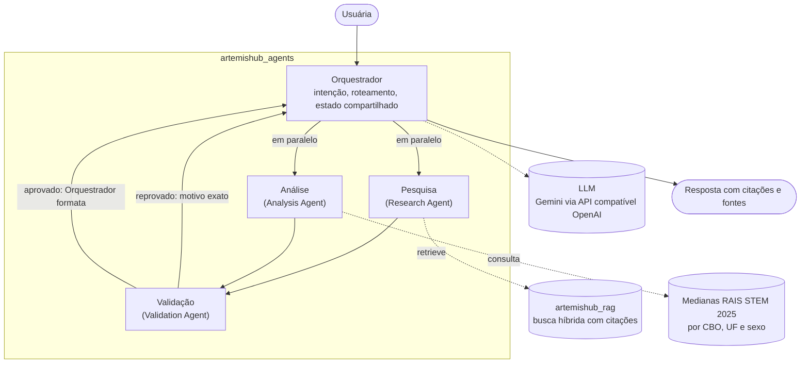
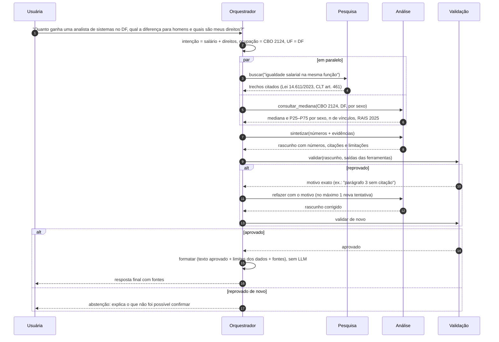

# Sistema multiagentes: primeiro protótipo (semana 4)

Documentação do entregável "Primeiro Protótipo Multiagente" (entrega em 20/11/2026): arquitetura dos agentes, responsabilidades e fluxo de colaboração. Segue o escopo do cronograma das semanas 4 a 7.

> **Status:** implementado em 19/11 com LangGraph (ADR-002) e rastreio no Langfuse. Em 19/11 o agente de Comunicação saiu do desenho, por sugestão do professor: o Orquestrador formata a resposta final, sem mais uma chamada ao LLM (ADR-011 no [artemishub_docs](https://github.com/ArtemisHubApp/artemishub_docs)). Spec: `docs/superpowers/specs/2026-11-19-prototipo-multiagente-design.md`.

## Objetivo do protótipo

Quatro agentes respondem juntos a uma pergunta que cruza as duas bases do Artemis: os dados salariais da RAIS e a base de direitos do RAG.

Pergunta principal da demonstração:

> "Quanto ganha uma analista de sistemas no DF, qual a diferença para homens e quais são meus direitos?"

O enunciado pede no mínimo 2 agentes especializados. O protótipo tem 3 especialistas (Research, Analysis e Validation) mais o Orquestrador, que também cumpre o papel de Communication: monta a resposta final por um template, sem chamar o LLM de novo. Assim cada pergunta usa **uma** chamada ao LLM (duas, se a Validação reprovar).

## Arquitetura



| Camada | Onde fica | Papel |
|---|---|---|
| Agentes | este repositório, `src/agentes/` (`domain`, `application`, `adapters`) | orquestração e os três especialistas |
| Base de direitos | [artemishub_rag](https://github.com/ArtemisHubApp/artemishub_rag) | busca híbrida (vetorial + BM25) e validação de citações |
| Dados salariais | `data/processed/rais_stem_2025_brasil.parquet` (DVC) | origem das medianas e percentis; ver [dicionário de dados](dicionario_dados_rais.md) |
| LLM | provedor externo, via `llm_client` | interpretar a pergunta, sintetizar e reescrever |

O LLM nunca calcula números. Valores salariais vêm só da ferramenta de consulta à RAIS, e o LLM apenas os explica.

## Responsabilidades

| Agente | Papel no enunciado | Responsabilidade | Entrada | Saída | Não faz |
|---|---|---|---|---|---|
| **Orquestrador** | coordenação | Entende a pergunta, decide quais agentes acionar, mantém o estado compartilhado, controla o limite de tentativas e formata a resposta final (texto aprovado sem alteração, limites dos dados e fontes citadas). Também aplica as regras de entrada (pergunta fora de escopo, tentativa de injeção). Tudo em código, sem LLM. | pergunta da usuária | intenção e parâmetros (ocupação, UF, salário informado) | inventar dados; seguir instruções vindas de documentos |
| **Pesquisa** | Research Agent | Consulta o RAG e devolve trechos com citação (fonte, página, artigo). | tema jurídico (ex.: igualdade salarial na mesma função) | lista de evidências citáveis | interpretar ou resumir a lei |
| **Análise** | Analysis Agent | Consulta as medianas e percentis da RAIS por ocupação, UF e sexo; cruza com as evidências da Pesquisa e sintetiza em até 3 parágrafos curtos, só com os números essenciais. Diz que a diferença é bruta; os demais limites (só emprego formal, ano dos dados) o Orquestrador mostra no fim da resposta. | parâmetros do Orquestrador + evidências | rascunho com números, citações e limitações | calcular números fora da ferramenta |
| **Validação** | Validation Agent | Confere se cada citação existe nas evidências, se cada número bate com a saída da ferramenta e se os avisos de limitação estão presentes. Se algo falhar, reprova com o motivo exato. | rascunho + saídas das ferramentas | aprovado, ou reprovado com motivo | reescrever a resposta |

### Regras da consulta salarial

- Grupo de comparação: família da CBO (4 dígitos) × UF × sexo, setor privado, RAIS 2025.
- Amostra mínima por recorte: 30 vínculos. Abaixo disso a ferramenta não devolve o número.
- Se a UF não tiver ao menos 30 mulheres e 30 homens na família, a consulta usa o Brasil todo e avisa. Se nem o Brasil tiver, devolve `suficiente: false` e nenhum número.
- A diferença entre mulheres e homens é **bruta**: compara medianas sem controlar escolaridade, tempo de casa ou jornada. Isso precisa aparecer na resposta. O controle por perfil é papel do modelo salarial (issues #4 e #5, semana 6).
- Além da mediana geral, a tabela traz a mediana só de quem tem jornada de 40 h ou mais (`p50_tempo_integral`), porque a jornada parcial, mais comum entre mulheres, puxa a mediana para baixo.

### Ferramenta salarial (`src/salarios.py`)

Os agentes não leem o parquet de 50 MB. Uma vez por versão da RAIS, `gerar` agrega o parquet em duas tabelas pequenas, versionadas no git em `data/agregados/`:

| Arquivo | Conteúdo |
|---|---|
| `salarios_rais_2025.csv` | n, P25, mediana, P75 e mediana em tempo integral por família da CBO × UF × sexo, incluindo os totais (`uf = BR`, `sexo = todos`) |
| `ocupacoes_cbo.csv` | ocupações de 6 dígitos com nome oficial e família, para achar a família a partir do que a usuária escreve |

```bash
uv run python -m src.salarios gerar --ano 2025
uv run python -m src.salarios consultar --ocupacao "analista de sistemas" --uf DF --salario 7500
```

O agente de Análise usa duas funções:

- `buscar_ocupacao("analista de sistemas")` devolve as ocupações mais parecidas e suas famílias (no exemplo, família 2124, Analistas de tecnologia da informação).
- `consultar("2124", "DF", salario=7500)` devolve os números por sexo, a diferença bruta, a posição do salário informado em relação às medianas, a fonte e os avisos que a resposta precisa repetir.

Exemplo real (RAIS 2025, analistas de TI no DF): mediana de R$ 7.000 para mulheres (4.657 vínculos) e R$ 8.462,79 para homens (19.410 vínculos), diferença bruta de 17,3%.

## Fluxo de interação



### Estado compartilhado

Todos os agentes leem e escrevem num único estado por execução. Cada agente escreve só nos seus campos.

| Campo | Escrito por | Conteúdo |
|---|---|---|
| `pergunta` | Orquestrador | texto original da usuária |
| `intencao`, `parametros` | Orquestrador | o que foi pedido; ocupação, UF, salário informado |
| `evidencias` | Pesquisa | trechos com id, fonte, URL, página e artigo |
| `dados_salariais` | Análise (via ferramenta) | mediana, percentis, n e ano, por sexo |
| `rascunho` | Análise | texto com marcações de citação |
| `validacao` | Validação | aprovado ou reprovado, com motivo |
| `tentativas` | Orquestrador | contador (limite: 1 nova tentativa) |
| `resposta_final` | Orquestrador | texto aprovado + limites dos dados + fontes citadas |

Não há memória entre conversas neste protótipo. Guardar o histórico da usuária exige decisão sobre a LGPD (RNF-07 e RNF-16) e fica registrado no ADR.

### Segurança

- Documentos do RAG e o texto da usuária são tratados como **dados**, nunca como instruções. Os agentes recebem esse conteúdo em campos delimitados.
- Os agentes não trocam mensagens livres entre si: a comunicação passa pelo estado e pelo Orquestrador.
- As ferramentas só leem dados.
- Testes de injeção de prompt entre agentes e via currículo estão previstos na semana 5.

## Demonstração

O executor da demonstração (tarefa 17) roda a pergunta pela linha de comando e mostra, passo a passo, o que cada agente fez.

```bash
cp .env.example .env    # LLM (Gemini) e Langfuse; sem chaves, roda com o redator padrão e sem rastreio
uv run python -m src.agentes.demo                       # pergunta da demonstração
uv run python -m src.agentes.demo "Sou analista de sistemas em SP e ganho R$ 7.500. Está justo?"
```

Para testar várias perguntas sem remontar os agentes a cada uma, use o chat no terminal:

```bash
uv run python -m src.agentes.chat
```

`/passos` liga e desliga o passo a passo de cada agente, `/esquecer` apaga a memória da conversa, `/ajuda` mostra os comandos e `/sair` (ou Ctrl+D) encerra.

**Memória da conversa:** o chat lembra só a intenção, a ocupação (família da CBO) e a UF da última pergunta atendida, para que "e no DF?" ou "e quanto ganha uma analista de sistemas?" continuem o assunto. Não guarda o valor do salário, o sexo, a raça nem a origem, e não envia histórico ao LLM: memória com dados pessoais é vetor de viés em conselhos salariais (relatório de vieses). A memória dura só enquanto o chat está aberto (porta `MemoriaDaConversa`, adaptador `MemoriaEmProcesso`); guardar conversas no Postgres depende da arquitetura do backend e da decisão de LGPD. No Langfuse, cada pergunta é um trace e a conversa inteira é uma sessão (`chat-…`), visível na tela Sessions.

Pré-requisito: o índice do `artemishub_rag` publicado (`uv run python -m src.pipeline` no rag). A Pesquisa roda o Retriever do rag no ambiente dele (`uv run --project`), porque os dois repos usam o pacote `src` (troca para import quando a rag#23 sair). Numa worktree, aponte `ARTEMIS_RAG_DIR` para o rag.

### Rastreio no Langfuse

Com `LANGFUSE_PUBLIC_KEY` e `LANGFUSE_SECRET_KEY`, cada pergunta vira um trace `responder-pergunta`:

| Observação | Tipo | O que mostra |
|---|---|---|
| `responder-pergunta` | agent (raiz) | pergunta e resposta final; metadata com aprovado, tentativas, evidências e redator |
| `orquestrador`, `pesquisa`, `analise_dados`, `analise_sintese`, `validacao`, `resposta` | chain (nós do LangGraph) | estado que entrou e saiu de cada nó |
| `verificar-entrada` | guardrail | se a pergunta foi bloqueada |
| `buscar-direitos` | retriever | tema, top_k e os trechos com citação |
| `consultar-rais` | tool | família da CBO, UF e os números da RAIS |
| `redigir-rascunho` | generation | prompt, resposta, modelo e tokens (só com LLM configurado) |
| `validar-rascunho` | evaluator | rascunho e veredito, com o motivo exato da reprovação |

Os nomes são estáveis: filtros, dashboards e avaliadores dependem deles.

### Ambientes, metadata e scores

- **Environment:** `development` (padrão) ou `demo`, com `--ambiente demo` no chat e na demo (`uv run python -m src.agentes.chat --ambiente demo`). `production` fica para a API do backend (#36). No Langfuse, o seletor de environment no topo separa os traces da apresentação dos testes.
- **Release:** o hash curto do commit em execução (`LANGFUSE_RELEASE`), para comparar versões.
- **Metadata do trace:** interface (`chat` ou `demo`), redator, modelo, modo do RAG, label do prompt, intenção, família da CBO, ocupação, UF pedida e UF usada, número de evidências e se havia salário informado. O valor do salário não entra na metadata nem nos scores (dado pessoal). Atenção: a pergunta vai como entrada do trace e os dados salariais vão na generation, então um salário escrito na pergunta aparece no Langfuse.
- **Scores por trace:** `validacao_aprovada`, `tentativas`, `abstencao`, `bloqueada` e `fora_de_escopo`. São rótulos definidos depois da execução, por isso são scores e não tags; servem para filtrar e montar painéis (por exemplo, taxa de abstenção por ocupação).

### Prompts no Langfuse

O texto dos prompts de LLM não fica no repositório, que é público: mora só no Langfuse, versionado e com label.

| Prompt | Tipo | Variáveis | Quem usa |
|---|---|---|---|
| `artemis/analise-rascunho` | chat | `pergunta`, `ocupacao`, `dados_salariais`, `evidencias`, `correcao` | Análise (síntese) |

- O código busca o prompt pelo label (`LANGFUSE_PROMPT_LABEL`, padrão `production`) e monta só as variáveis. A generation `redigir-rascunho` fica ligada ao nome e à versão do prompt no trace.
- Para mudar o prompt: crie uma nova versão no Langfuse, teste com outro label (por exemplo `staging`, com `LANGFUSE_PROMPT_LABEL=staging`) e só então mova o label `production`. Não precisa de deploy.
- Sem Langfuse ou sem o prompt, a Análise usa o rascunho padrão (sem LLM), nunca uma cópia do prompt. Um teste (`tests/agentes/test_seguranca.py`) falha se texto de prompt aparecer em `src/`.
- Versões antigas do prompt continuam no histórico do git (commits anteriores a esta mudança).

**Enquadramento atual (versão 1):** a mediana dos homens na mesma ocupação e UF aparece como referência provisória para negociar; a mediana das mulheres, como o retrato do mercado, que carrega a desigualdade. O sexo da usuária nunca muda a referência. Base científica e decisões em aberto no relatório de vieses do projeto; a referência definitiva virá do modelo salarial (#4, #5).

## Limitações conhecidas

- **Validação por regras:** ela confere citações, valores, percentuais, o aviso de diferença bruta e o sentido da diferença. Não confere afirmações qualitativas sem número (por exemplo, "a empresa é obrigada a…"); isso é papel do juiz por LLM, que entra na semana 5.
- **Valores das evidências:** um valor em R$ ou percentual que aparece em qualquer trecho recuperado é aceito em qualquer parágrafo, mesmo que aquele trecho não seja citado ali.
- **Ocupação:** `buscar_ocupacao` acha a ocupação por palavras do nome na CBO. Erros de digitação são corrigidos pela palavra mais parecida dos nomes da CBO ("cientsita" → "cientista"). Termos que não estão nos nomes oficiais ("engenheira de software") podem cair numa ocupação parecida; o passo a passo mostra qual ocupação e família foram usadas.
- **Guardrail:** é uma lista de padrões, não um classificador. Tentativas de injeção reescritas podem passar; a defesa é em camadas (dados entre delimitadores, roteamento em código e Validação).
- **Latência:** medida em 19/11 com cache quente, a pergunta da demonstração leva cerca de 25 s: o Gemini (`gemini-3.5-flash-lite`) leva 13 s e a busca no RAG 6,5 s, porque o subprocesso carrega o modelo de embeddings a cada pergunta. Pergunta só de salário leva cerca de 11 s. A primeira execução da máquina leva mais de 1 minuto (download e carga do modelo). A meta do PDR é de até 10 s: o import direto do RAG (#37) e uma API que mantém o modelo carregado (#36) devem resolver a parte do RAG.
- **Delimitadores do prompt:** um trecho do RAG que contenha `</evidencias>` fecha a tag antes da hora.

## Próximas etapas

| Semana | O que entra |
|---|---|
| 5 | Agente de currículo (PDF e imagem), negociação em texto e áudio, testes de injeção, avaliadores e datasets no Langfuse |
| 6 | Modelo de faixa salarial com referência sem a diferença de gênero e avaliação de equidade; orquestrador exposto como API para o backend |
| 7 | Testes com usuárias, avaliação final, relatório e apresentação |

A visão completa da arquitetura (todos os agentes previstos, Langfuse e o desenho do modelo salarial) está na [versão interativa do diagrama](https://claude.ai/artifact/UqcHtU3CDDevZo89fgTTZb).
